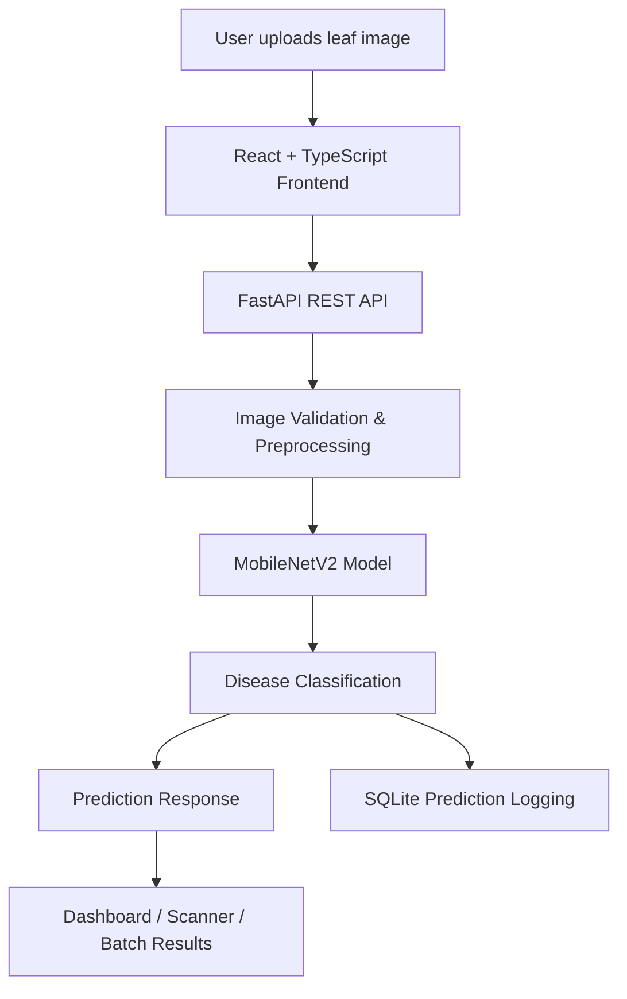

# 🌿 Vistara AI
### See the disease. Understand the prediction. Protect the harvest.

<p align="center">
  <strong>An AI-powered plant disease detection platform built with Deep Learning and Computer Vision.</strong>
  <br />
  Upload a leaf image, receive a model prediction, and explore the results through an interactive dashboard.
</p>

<p align="center">
  
  
  
  
</p>

---

## 🌱 About the Project

Plant diseases can significantly affect agricultural productivity. Identifying them early is important, but manual identification can require time and specialized knowledge.

**Vistara AI** explores how deep learning and computer vision can assist with plant disease identification.

The platform uses a trained **MobileNetV2 convolutional neural network** to analyze leaf images and predict one of 38 plant disease or healthy-leaf categories from the PlantVillage dataset.

Rather than being just a model wrapped in a web page, Vistara AI brings together model inference, a FastAPI backend, SQLite-based prediction logging, and a modern interactive dashboard.

> **Our vision:** Make AI-assisted plant disease analysis more accessible through a simple, intuitive, and transparent interface.

## ✨ Features

### 🔬 AI-Powered Leaf Analysis
- Deep learning inference using a trained MobileNetV2 model.
- Supports 38 PlantVillage classification categories.
- Displays the predicted class and model-generated score.
- Shows alternative top predictions where available.

### 📸 Image Scanner
- Upload leaf images for individual analysis.
- Preview images before submitting them.
- Receive predictions from the actual trained model.
- View inference time and prediction details.

### 📊 Batch Analysis
- Upload and analyze multiple images in one operation.
- Process images through the real backend inference pipeline.
- View individual results and processing statuses.
- Distinguish real model predictions from illustrative demo records.

### 🗄️ Prediction Logging
- FastAPI backend integrated with SQLite.
- Stores prediction records and batch-processing information.
- Tracks prediction status and inference metadata.

### 🎨 Interactive Dashboard
- Modern dashboard interface.
- Responsive React-based frontend.
- Data visualizations and analytical summaries.
- Dedicated scanner and batch-analysis views.

---

## 🧠 Machine Learning Model

| Component | Details |
|---|---|
| Model architecture | MobileNetV2 |
| Learning approach | Transfer Learning |
| Framework | TensorFlow / Keras |
| Dataset | PlantVillage |
| Number of classes | 38 |
| Model format | `.keras` |
| Model parameters | 2,306,662 |
| Model file size | Approximately 21.26 MB |

### Dataset

Vistara AI uses the **PlantVillage dataset**, containing approximately 54,303 images across 38 plant disease and healthy-leaf categories.

The dataset is used for training, validation, and testing through a stratified split:

- Training: 70%
- Validation: 15%
- Testing: 15%

### Model Performance

The following metrics were measured on the held-out PlantVillage test set:

| Evaluation Metric | Result |
|---|---:|
| Accuracy | **98.04%** |
| Macro F1-score | **0.9747** |
| Weighted F1-score | **0.9803** |

These results represent performance on the held-out dataset, not guaranteed accuracy on photographs taken in real agricultural environments.

---

## 🏗️ System Architecture

Vistara AI follows a frontend–backend architecture in which the React application communicates with a FastAPI service.



### Technology Stack

| Layer | Technologies |
|---|---|
| Frontend | React 19, TypeScript, Vite 8 |
| Styling | Tailwind CSS |
| Icons | Lucide |
| Charts | Recharts |
| Backend | Python, FastAPI |
| Validation | Pydantic v2 |
| Machine Learning | TensorFlow, Keras, MobileNetV2 |
| Image Processing | Pillow |
| Database | SQLite (`sqlite3`) |
| API Communication | REST, HTTP, JSON, Multipart Form Data |

---

## 📁 Project Structure

```text
Vistara_Ai/
│
├── backend/
│   ├── app/
│   │   ├── api/
│   │   │   └── v1/
│   │   │       └── routes/
│   │   │           └── predict.py
│   │   ├── schemas/
│   │   ├── services/
│   │   └── main.py
│   │
│   ├── data/
│   │   └── model/
│   │       ├── best_vistara_model.keras
│   │       ├── classes.json
│   │       └── evaluation_report.json
│   │
│   └── tests/
│
├── frontend/
│   ├── src/
│   │   ├── components/
│   │   ├── pages/
│   │   ├── services/
│   │   └── types/
│   ├── public/
│   └── package.json
│
├── AGENTS.md
├── PROJECT_CONTEXT.md
└── README.md
```

*The model artifacts are kept locally and are not committed to the Git repository.*

---

## 🚀 Getting Started

Follow these steps to run Vistara AI locally.

### Prerequisites

Make sure you have installed:

- Python 3.12
- Node.js and npm
- Git

### 1. Clone the Repository

```bash
git clone https://github.com/akhil3145/vistara-ai.git
cd vistara-ai
```

### 2. Backend Setup

Open a terminal:

```bash
cd backend

python -m venv .venv
```

Activate the virtual environment on Windows:

```powershell
.venv\Scripts\activate
```

Install the backend dependencies:

```bash
pip install -r requirements.txt
```

**Model setup**

The trained model files are not included in the repository. Place the required artifacts in:

```text
backend/data/model/
```

Required files:

```text
best_vistara_model.keras
classes.json
evaluation_report.json
```

The model and class mapping must correspond to the same training run.

Start the backend:

```bash
python -m uvicorn app.main:app --reload
```

Backend API:

```text
http://127.0.0.1:8000
```

Interactive API documentation:

```text
http://127.0.0.1:8000/docs
```

### 3. Frontend Setup

Open another terminal:

```bash
cd frontend

npm install
```

Create a `.env` file in the frontend directory:

```env
VITE_API_BASE_URL=http://127.0.0.1:8000
```

Start the frontend:

```bash
npm run dev
```

Open the local application:

```text
http://localhost:5173
```

---

## 🔌 API Endpoints

The backend exposes versioned REST API endpoints.

| Method | Endpoint | Purpose |
|---|---|---|
| POST | `/api/v1/predict` | Single-image prediction |
| POST | `/api/v1/predict/batch` | Batch image prediction |

### Batch Prediction

The batch endpoint accepts multiple image files using multipart form data.

**Request field:** `files`

**Supported formats:** JPEG, PNG, WEBP

**Limits:** Up to 24 images per batch, with a maximum size of 10 MB per image.

The batch endpoint supports individual item statuses and overall batch statuses, including:

- `success`
- `partial_success`
- `rejected`
- `model_unavailable`
- `error`

---

## 🧪 Testing & Validation

The project has undergone backend and frontend testing.

| Check | Result |
|---|---|
| Backend automated tests | 22 passed |
| Python compilation check | Passed |
| Frontend lint | 0 warnings, 0 errors |
| Frontend production build | Passed |
| Single-image inference integration | Tested |
| Real batch inference integration | Tested |
| Batch API response | HTTP 200 in successful test |

A live batch test was performed using two leaf images, with both predictions returned by the actual trained model.

---

## ⚠️ Current Limitations

Vistara AI is an academic and experimental project under active development.

- Model performance is evaluated on PlantVillage images, which are largely captured under controlled conditions.
- Real-world performance may differ due to lighting, image quality, backgrounds, camera differences, and other environmental factors.
- Model output scores are not calibrated probabilities and should not be interpreted as certainty.
- A prediction is not a substitute for expert agricultural diagnosis.
- Grad-CAM explainability is planned but is not yet implemented.
- Prediction history, analytics, and other dashboard capabilities may continue to evolve.

We believe in documenting limitations rather than presenting experimental results as guarantees.

---

## 🛣️ Roadmap

- [x] Project architecture and frontend foundation
- [x] Interactive dashboard implementation
- [x] FastAPI backend integration
- [x] SQLite prediction logging
- [x] MobileNetV2 model training
- [x] Single-image real inference
- [x] Real batch inference
- [x] Frontend production build and lint validation
- [ ] Verify CSV export with real inference results
- [ ] Complete prediction history and analytics
- [ ] Implement Grad-CAM explainability
- [ ] Improve documentation and deployment
- [ ] Final testing and demonstration

---

## 👨‍💻 Author

**Akhil Pandey**

B.Tech — Computer Science and Engineering  
Specialization: Data Science & Artificial Intelligence

- GitHub: [@akhil3145](https://github.com/akhil3145)
- Project Repository: [Vistara AI](https://github.com/akhil3145/vistara-ai)

---

## 📜 License

This project is currently developed for academic and educational purposes. A formal open-source license will be added after its licensing terms are finalized.

---

<p align="center">
  <strong>🌿 Vistara AI — Exploring the intersection of Agriculture, AI, and Computer Vision.</strong>
  <br />
  <sub>Built with curiosity, code, and a little bit of deep learning.</sub>
</p>
