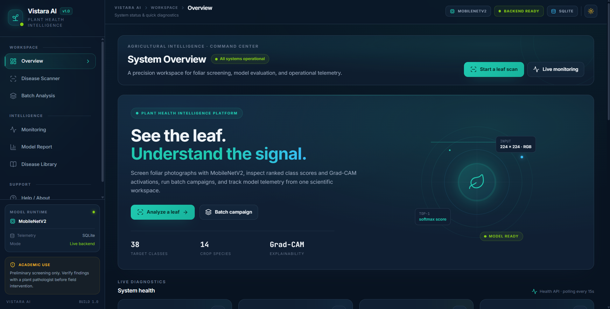
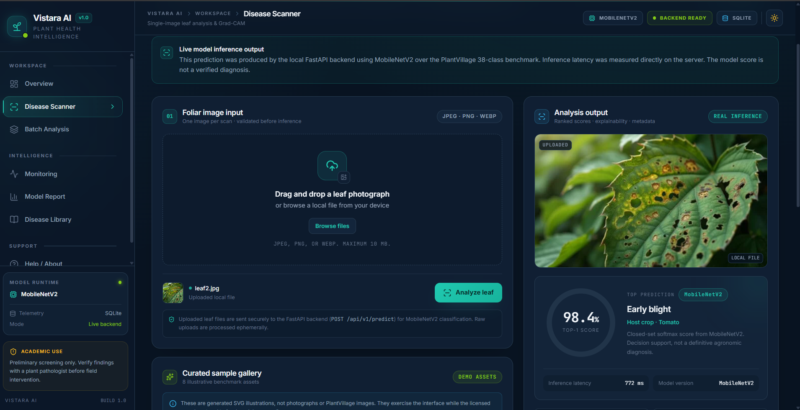
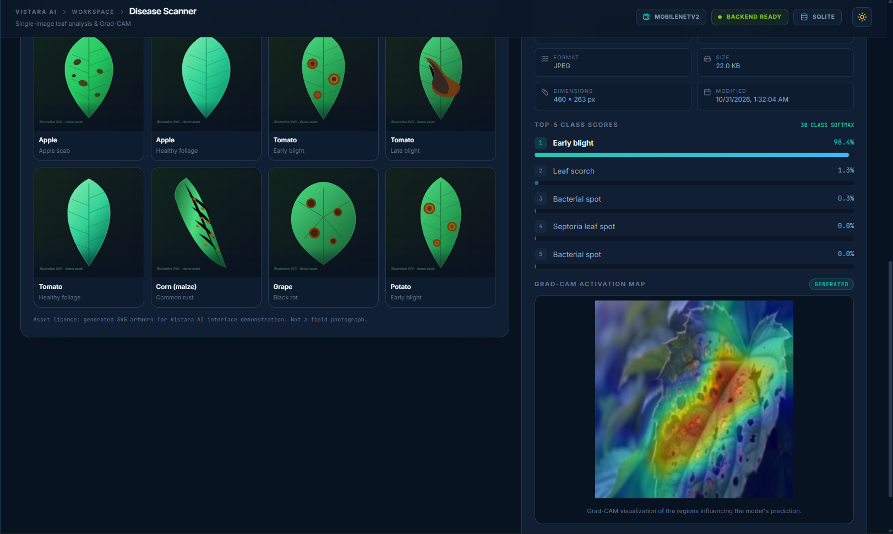
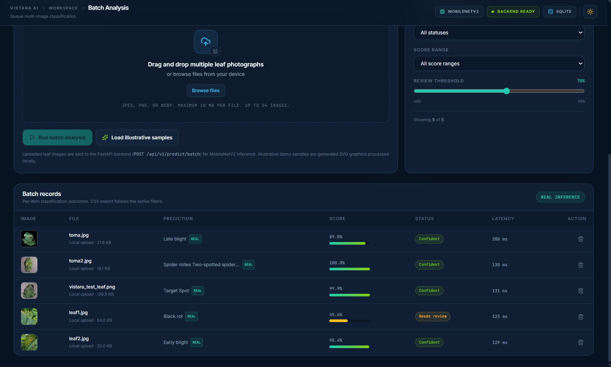
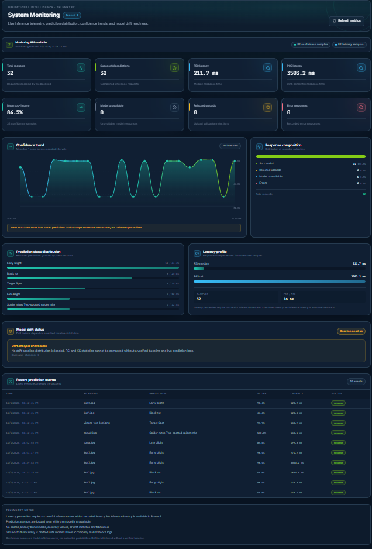
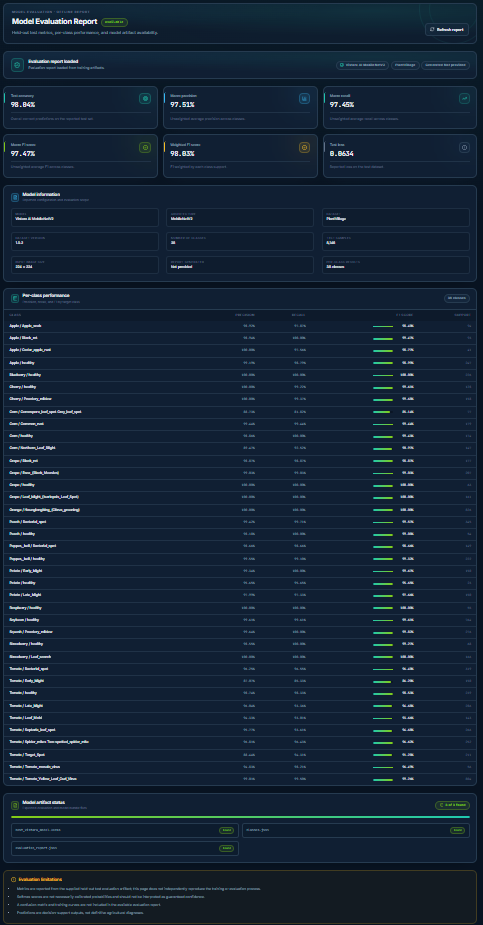
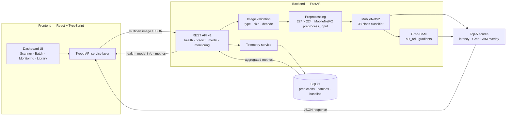

<h1 align="center">🌿 VISTARA AI</h1>

<h3 align="center">AI-Powered Plant Disease Intelligence</h3>

<p align="center">
  A deep learning platform for preliminary leaf disease screening, built with
  <strong>MobileNetV2</strong>, <strong>FastAPI</strong>, and a real-time React dashboard.
  Upload a leaf, inspect class scores, understand the prediction with Grad-CAM,
  and review operational telemetry.
</p>

<p align="center">
  
  
  
  
  
  
  
  
</p>

<p align="center">
  <a href="#demo"><strong>Demo</strong></a> ·
  <a href="#features"><strong>Features</strong></a> ·
  <a href="#evaluation"><strong>Evaluation</strong></a> ·
  <a href="#architecture"><strong>Architecture</strong></a> ·
  <a href="#quick-start"><strong>Quick Start</strong></a> ·
  <a href="#api"><strong>API</strong></a> ·
  <a href="#project-team"><strong>Project Team</strong></a>
</p>

<p align="center">
  <sub>Educational and preliminary decision-support software — not an agricultural diagnostic authority.</sub>
</p>

---

<a id="demo"></a>
## 📸 Application Demo

Vistara AI combines a focused scanning workflow with the operational context needed to understand how a model is behaving. The screenshots below were captured from the production UI.

### Overview Dashboard

<!-- overview.png: Overview dashboard with the hero, live backend status, model runtime, and system health. -->


The landing surface reports backend reachability, model availability, dataset coverage, and the current operational posture before a user starts a scan.

### AI Disease Scanner

<!-- scanner.png: Single-image scanner with a real uploaded leaf, live inference banner, and top-1 result. -->


Upload a leaf image and receive a ranked top-5 classification. Each score is the model's softmax output for a closed-set class — useful for comparison, not a calibrated probability.

- Drag-and-drop or file-picker upload with client-side type and size checks.
- Ranked predictions with crop, class label, and score.
- Server-generated Grad-CAM overlay for the leading class.
- Explicit live-backend versus demo-preview state.

### Grad-CAM Explainability

<!-- gradcam.png: Ranked top-5 class scores beside the generated Grad-CAM activation overlay. -->


Grad-CAM highlights spatial regions that contributed to the selected class score. It is an interpretability aid, not biological proof or a segmentation mask.

### Batch Analysis

<!-- batch.png: Batch workspace with upload controls, review threshold, and per-file classification outcomes. -->


Process up to 24 images in one request, with per-file statuses, accepted/rejected counts, ranked predictions, and a filtered CSV export. Demo rows remain explicitly marked in the exported file.

### Monitoring Dashboard

<!-- monitoring.png: Monitoring dashboard with request totals, confidence trend, class distribution, latency, drift status, and recent events. -->


Monitoring surfaces request volume, class distribution, mean confidence, latency percentiles, recent events, and batch activity. Drift status is shown honestly as unavailable until a verified baseline distribution is loaded.

### Model Evaluation Report

<!-- model-report.png: Model report with benchmark metrics, model information, per-class performance, and artifact status. -->


The evaluation view reads the project's held-out benchmark artifact and presents the headline metrics, per-class performance, and model metadata alongside their provenance.

---

## 🎥 Project Walkthrough

<!-- Upload your demo video or add its hosted URL here. -->

Coming soon — a short walkthrough will cover a live scan, Grad-CAM, batch processing, monitoring, and the model report.

---

## 🧠 About Vistara AI

Plant disease identification is time-sensitive, knowledge-intensive, and often constrained by access to specialists. Vistara AI explores how deep learning can support an earlier, more informed first look at a leaf — while keeping the limits of the model visible.

The platform classifies a leaf image into one of **38 PlantVillage categories across 14 crop species**, then presents the result through a dashboard built for inspection rather than spectacle. A scan is not just a label: it includes ranked scores, an explainability overlay, latency, request telemetry, and a clear distinction between a real backend response and an illustrative demo state.

### What makes it more than a model demo

- **Real inference path** — uploaded images are validated, resized to 224 × 224, preprocessed for MobileNetV2, and scored by the loaded Keras model.
- **Explainability built into the workflow** — Grad-CAM is generated server-side from MobileNetV2 feature maps and returned with the prediction.
- **Operational feedback** — SQLite telemetry powers monitoring views for request volume, confidence, latency, class mix, and batch outcomes.
- **Honest states** — the UI distinguishes live predictions from demo previews, and reports drift as unavailable until a baseline exists.
- **Evaluation provenance** — the model report reads a stored evaluation artifact instead of hard-coding marketing numbers.

> **Scope:** This is an educational and preliminary decision-support tool. It does not replace scouting, laboratory testing, or professional agronomic advice.

---

<a id="features"></a>
## ✨ Features

| Capability | What ships today |
| --- | --- |
| 🔬 **38-class leaf classification** | MobileNetV2 transfer-learning model covering 38 disease and healthy-leaf classes across 14 crop species. |
| 📤 **AI disease scanner** | Single-image upload with type/size validation, ranked top-5 predictions, and class scores. |
| 🖼️ **Grad-CAM explainability** | Server-generated heatmap overlay for the leading prediction; a heatmap failure never blocks a prediction. |
| 📦 **Batch analysis** | Up to 24 images per request with per-file status, accepted/rejected counts, and aggregate results. |
| 📄 **Filter-aware CSV export** | Export batch results after filtering; demo-generated rows stay explicitly marked. |
| 📚 **Disease library** | Searchable reference for the model's 38 classes, including crop grouping and curated sample assets. |
| 📈 **Monitoring dashboard** | Request trends, class distribution, mean score, p50/p95 latency, recent events, and batch activity. |
| 🩺 **Drift status** | Exposes `empty`, `partial`, and `available` states without inventing a drift score when no baseline is configured. |
| 🗂️ **Model evaluation report** | Reads stored metrics and per-class performance from the model artifact bundle. |
| 🧪 **Demo/live distinction** | Real uploads always use the live backend; bundled illustrative samples are visual demos and are badged as such. |
| 🧱 **Typed API boundary** | Pydantic v2 response contracts, camelCase JSON, explicit error codes, and typed frontend service methods. |
| 📱 **Responsive dark UI** | Tokenized Tailwind design system, mobile navigation, keyboard-accessible controls, and reduced-motion support. |

---

<a id="evaluation"></a>
## 📊 Model Evaluation

> **Reported held-out results** from `backend/data/model/evaluation_report.json`, generated on the PlantVillage dataset (v1.0.2). These are controlled benchmark figures — not field-condition accuracy.

| Metric | Result |
| --- | ---: |
| **Test accuracy** | **98.04%** |
| Macro precision | 97.51% |
| Macro recall | 97.45% |
| Macro F1 | 97.47% |
| Weighted F1 | 98.03% |
| Test loss | 0.0634 |
| Test samples | 8,146 |
| Classes | 38 |
| Input resolution | 224 × 224 |

### Lowest per-class F1 in the evaluation artifact

| Class | F1 | Support |
| --- | ---: | ---: |
| Corn — Cercospora / gray leaf spot | 0.8514 | 77 |
| Tomato — Early blight | 0.8620 | 150 |
| Corn — Northern leaf blight | 0.9097 | 147 |
| Tomato — Target spot | 0.9128 | 211 |
| Tomato — Leaf mold | 0.9366 | 143 |

These are the classes where the closed-set benchmark is weakest. They are useful for prioritizing inspection and future data work, not for estimating real-world failure rates.

---

## 🔍 Explainability with Grad-CAM

Vistara AI implements Grad-CAM against the MobileNetV2 `out_relu` feature maps:

1. The model runs a forward pass for the selected class.
2. Gradients of the class logit are taken with respect to the final convolutional feature maps.
3. Feature maps are weighted by globally pooled gradients, passed through ReLU, normalized, and resized to the input image.
4. A jet-colormap heatmap is blended with the original leaf and returned as a base64 PNG (`gradcamImage`).

<!-- gradcam.png: Grad-CAM overlay highlighting the regions that influenced the predicted class. -->


**Interpret it carefully:** a warm region indicates where the model's activation contributed to the selected class. It does not prove the presence of a pathogen, identify a disease mechanism, or establish that the model used botanically meaningful evidence.

---

<a id="architecture"></a>
## 🏗️ System Architecture



### Request lifecycle

| Stage | Implementation |
| --- | --- |
| 1. Validate | Server-side extension, declared MIME type, size limit, and decode checks; batch requests validate per file. |
| 2. Preprocess | Convert to RGB, resize to 224 × 224, convert to a float batch, and apply MobileNetV2 preprocessing. |
| 3. Infer | Run the loaded `.keras` model and rank the top-5 class scores. |
| 4. Explain | Generate a Grad-CAM overlay for the leading class on the single-image path. |
| 5. Record | Log prediction telemetry to SQLite, including demo flags, latency, and batch outcomes. |
| 6. Report | Aggregate recent predictions into monitoring metrics; serve model metadata and the evaluation artifact separately. |

The backend reports demo state as `isDemo: false` for real inference. The frontend drives its live/demo banner from backend health and model readiness, not from a hard-coded flag.

---

## 🛠️ Technology Stack

| Layer | Technologies |
| --- | --- |
| **Frontend** | React 19, TypeScript, Vite 8 |
| **Styling** | Tailwind CSS 3.4, custom semantic design tokens, Inter + JetBrains Mono |
| **UI & icons** | Lucide React, custom accessible primitives |
| **Data visualization** | Project-native SVG/CSS chart components (`TrendChart`, `DistributionBars`) — no third-party charting dependency |
| **Backend** | Python 3.12, FastAPI, Uvicorn |
| **Contracts** | Pydantic v2, pydantic-settings, camelCase JSON models |
| **Machine learning** | TensorFlow / Keras, MobileNetV2 transfer learning |
| **Image processing** | Pillow, NumPy |
| **Explainability** | Grad-CAM over MobileNetV2 `out_relu` |
| **Persistence** | SQLite through Python's standard-library `sqlite3` |
| **Quality** | Pytest, Oxlint, TypeScript project build |

---

## 📁 Project Structure

```text
Vistara_Ai/
├── backend/
│   ├── app/
│   │   ├── api/v1/routes/        # health, predict, model, monitoring
│   │   ├── repositories/         # SQLite persistence
│   │   ├── schemas/              # Pydantic response/request contracts
│   │   ├── services/             # prediction, Grad-CAM, model, monitoring
│   │   ├── config.py             # environment and CORS settings
│   │   ├── database.py           # SQLite setup and lifecycle
│   │   ├── exceptions.py         # domain errors
│   │   └── main.py               # FastAPI application factory
│   ├── data/                     # gitignored local runtime data
│   │   ├── model/                # .keras bundle, classes, evaluation report
│   │   └── test_images/          # local validation images
│   ├── tests/                    # API, batch, database, monitoring tests
│   ├── requirements.txt
│   ├── requirements-dev.txt
│   └── .env.example
├── frontend/
│   ├── public/
│   │   ├── samples/              # illustrative scanner images
│   │   ├── favicon.svg
│   │   └── icons.svg
│   ├── src/
│   │   ├── assets/               # local visual assets
│   │   ├── components/           # batch, charts, layout, library, scanner, ui
│   │   ├── context/              # app-wide state
│   │   ├── data/                 # class library and display metadata
│   │   ├── lib/                  # formatting and shared helpers
│   │   ├── pages/                # Overview, Scanner, Batch, Library, Monitoring...
│   │   ├── services/             # typed API client and health polling
│   │   ├── types/                # shared TypeScript contracts
│   │   ├── App.tsx
│   │   ├── index.css
│   │   └── main.tsx
│   ├── index.html
│   ├── package.json
│   ├── tailwind.config.js
│   └── vite.config.ts
├── docs/
│   └── screenshots/              # README screenshots
├── AGENTS.md
├── LICENSE
├── PROJECT_CONTEXT.md
└── README.md
```

> `backend/data/` and `*.keras` files are intentionally gitignored. Model artifacts are produced through the Colab training workflow and placed locally; they are not committed to this repository.

---

<a id="quick-start"></a>
## 🚀 Getting Started

### Prerequisites

| Requirement | Version |
| --- | --- |
| Python | 3.12+ |
| Node.js | 20.19+ or 22.12+ |
| npm | 10+ |
| Git | Current release |

TensorFlow and the model bundle add several hundred megabytes to the local footprint. Real inference requires both.

### 1. Clone and enter the repository

```powershell
git clone https://github.com/akhil3145/vistara-ai.git
Set-Location vistara-ai
```

### 2. Create the backend environment

```powershell
Set-Location backend
python -m venv .venv
.\.venv\Scripts\Activate.ps1
python -m pip install --upgrade pip
pip install -r requirements-dev.txt
pip install tensorflow
```

`requirements.txt` covers the web stack. TensorFlow is installed separately because the runtime model bundle is optional for tests that mock inference.

### 3. Place the model artifacts

Create the local model directory and add the verified bundle:

```text
backend/data/model/
├── best_vistara_model.keras   # required for live inference
├── classes.json               # required; class-id to label mapping
└── evaluation_report.json     # required for the evaluation report view
```

The artifact directory can be overridden with `VISTARA_MODEL_ARTIFACTS_DIR`. Keep the class order and preprocessing contract aligned with the trained model — a mismatched `classes.json` silently produces wrong labels.

### 4. Configure and start the backend

```powershell
Copy-Item .env.example .env
python -m uvicorn app.main:app --reload --host 127.0.0.1 --port 8000
```

Verify that the API, database, and model are ready before opening the UI:

```powershell
Invoke-RestMethod http://127.0.0.1:8000/api/v1/health | ConvertTo-Json -Depth 5
```

- API root: `http://127.0.0.1:8000`
- Interactive docs: `http://127.0.0.1:8000/docs`
- Health: `http://127.0.0.1:8000/api/v1/health`

The first startup loads TensorFlow and the Keras model, so it can take noticeably longer than later requests.

### 5. Configure and start the frontend

Open a second PowerShell terminal:

```powershell
Set-Location frontend
Copy-Item .env.example .env
npm install
npm run dev
```

Open `http://localhost:5173`.

The frontend reads `VITE_API_BASE_URL` from `.env`. In development, the backend accepts local origins on any port for `localhost`, `127.0.0.1`, and `[::1]`; production requires explicitly configured origins.

### 6. Verify the build

```powershell
npm run lint
npm run build
```

The build runs TypeScript project checks before Vite bundles the application.

---

<a id="api"></a>
## 🔌 API Endpoints

Base path: `/api/v1`

| Method | Endpoint | Purpose |
| --- | --- | --- |
| `GET` | `/health` | Backend heartbeat, database status, and model readiness. |
| `GET` | `/model/info` | Model metadata, class count, input size, and artifact availability. |
| `GET` | `/model/report` | Stored evaluation metrics and per-class performance. |
| `GET` | `/monitoring/metrics` | Aggregated request telemetry, latency, class distribution, and drift status. |
| `POST` | `/predict` | Single-image multipart prediction with top-5 scores and an optional Grad-CAM image. |
| `POST` | `/predict/batch` | Multi-image multipart prediction with per-file results and a batch summary. |

### Single-image prediction

```powershell
curl.exe -X POST "http://127.0.0.1:8000/api/v1/predict" `
  -F "file=@C:\path\to\leaf.jpg"
```

Key response fields: `status`, `isDemo`, `requestId`, `filename`, `elapsedMs`, `predictions[]`, `gradcamImage`, and `logged`.

### Batch prediction

```powershell
curl.exe -X POST "http://127.0.0.1:8000/api/v1/predict/batch" `
  -F "files=@C:\path\to\leaf-1.jpg" `
  -F "files=@C:\path\to\leaf-2.png"
```

Key response fields: `status`, `batchId`, `itemCount`, `acceptedCount`, `rejectedCount`, `items[]`, and aggregate `predictions[]`.

### Response and error behavior

- Predictions use camelCase JSON through Pydantic models.
- A real backend response always sets `isDemo` to `false`.
- Invalid images return explicit validation errors; one rejected batch file does not hide successful files.
- If the model cannot load, prediction endpoints return `model_unavailable` rather than fabricated scores.
- Upload limits default to 10 MB per file and 24 files per batch; both are configurable through backend environment variables.

---

## ⚠️ Limitations

- **Benchmark, not field performance.** The reported metrics come from PlantVillage-style images with controlled backgrounds and lighting. Real field images introduce occlusion, motion blur, multiple leaves, soil, and unseen conditions.
- **Closed-set classification.** The model always chooses among 38 known classes. An out-of-distribution leaf, a non-leaf image, or a disease outside the training set can still receive a confident-looking score.
- **Scores are not calibrated probabilities.** Softmax outputs rank alternatives under the model's learned distribution; they should not be read as clinical or agronomic confidence.
- **Grad-CAM is not evidence.** Heatmaps show activation influence, not pathogen presence, lesion segmentation, or causal reasoning.
- **Drift is not scored without a baseline.** The monitoring API exposes drift state and returns `unavailable` until a verified baseline distribution is configured; PSI/KS scoring is not enabled in this build.
- **Limited crop coverage.** The 38 classes cover 14 crop species from the PlantVillage collection, not the full range of agricultural disease.
- **Not a diagnostic authority.** Every prediction requires expert verification before any treatment, quarantine, or economic decision.
- **Single-user development scope.** There is no authentication layer, multi-tenant isolation, or production deployment configuration in this repository.
- **Local resource requirements.** TensorFlow and the model bundle are heavy for a laptop; training is intentionally separated into a Colab workflow.

---

## 🚧 Future Improvements

- Validate on field-collected images and add a domain-shift evaluation suite.
- Add probability calibration and expected-calibration-error reporting.
- Load a verified reference distribution and enable PSI/KS drift scoring with alert thresholds.
- Surface confusion matrices, training curves, and per-class error analysis in the model report.
- Add model versioning and side-by-side comparison of evaluation runs.
- Provide human-in-the-loop review and an expert feedback loop for flagged predictions.
- Add export formats for downstream review, such as structured JSON alongside CSV.
- Evaluate quantization or ONNX/TFLite export only after a deployment target and accuracy budget are defined.
- Add continuous integration for backend tests, frontend lint, TypeScript build, and screenshot checks.
- Package the stack with Docker Compose for reproducible local setup.

---

<a id="project-team"></a>
## 👥 Project Team

<p align="center">The team behind Vistara AI.</p>

<!-- Replace the placeholder GitHub URLs for Divyansh Tiwari and Aryan Verma with their actual profiles. -->

<table align="center">
  <tr>
    <td align="center" width="33%">
      <strong>Akhil Pandey</strong><br />
      <sub>Project Developer</sub><br /><br />
      <a href="https://github.com/akhil3145">GitHub</a>
    </td>
    <td align="center" width="33%">
      <strong>Divyansh Tiwari</strong><br />
      <sub>Team Member</sub><br /><br />
      <a href="https://github.com/REPLACE-DIVYANSH">GitHub profile (placeholder)</a>
    </td>
    <td align="center" width="33%">
      <strong>Aryan Verma</strong><br />
      <sub>Team Member</sub><br /><br />
      <a href="https://github.com/REPLACE-ARYAN">GitHub profile (placeholder)</a>
    </td>
  </tr>
</table>

---

## 📄 License

Released under the [MIT License](LICENSE). Copyright © 2026 Akhil Pandey.

<p align="center">
  <sub>If Vistara AI is useful to your work, consider starring the repository.</sub>
</p>
